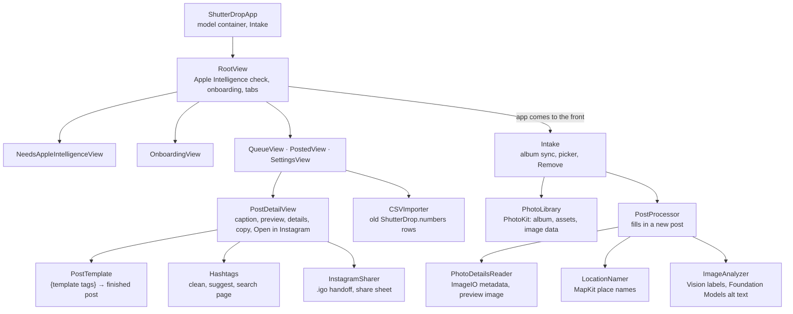

# How ShutterDrop is put together

ShutterDrop is one SwiftUI app, `app/Sources/ShutterDrop`, built from the Xcode project `app/ShutterDrop.xcodeproj`. The project uses synchronized folders, so every file in `Sources/ShutterDrop` is part of the app and every file in `Tests/ShutterDropTests` part of the tests, with no project edits for new files.

## Who owns what

| Piece | Isolation | Owns |
| --- | --- | --- |
| `Post` | SwiftData model | One photo on its way to Instagram: what was read from it, what the user typed, and whether it's posted. Keyed by the photo's Photos library ID |
| `PostTemplate` | — | Turning a template and a post's values into the finished post: filling tags, dropping lines whose tags are all empty, collapsing blank lines |
| `PostFormat` | — | How readings read in a post: "1/125", "f/5.6", "Model with Lens", "March 1, 2025" |
| `PhotoLibrary` | main actor, `@Observable` | PhotoKit: permission, the ShutterDrop album, assets and their image data |
| `Intake` | main actor, `@Observable` | How photos get into the queue and leave it: album sync, the photo picker, Remove |
| `PostProcessor` | main actor | Filling in a new post: details, place name, Vision labels, alt text |
| `PhotoDetailsReader` | — | EXIF, TIFF and GPS metadata, and the upright 1568 px copy the models see |
| `LocationNamer` | — | MapKit reverse geocoding and nearby landmarks, and the rules for which name to use |
| `ImageAnalyzer` | — | Vision scene labels and text recognition, and the alt text prompt |
| `AppleIntelligence` | — | Whether the on-device model can run, as one of four states |
| `Hashtags` | — | Cleaning pasted text, suggestions, the search page address |
| `InstagramSharer` | main actor | Handing the photo to Instagram as an `.igo` file, or the share sheet |
| `CSVImporter` | `importPosts` on the main actor | Parsing the old sheet's CSV and matching rows to photos |
| `AppSettings` | — | Settings keys and defaults, shared by `@AppStorage` and services |
| `DebugOptions` | — | Launch arguments for simulator screenshots. Debug builds only |

## Rules that hold everywhere

- **Nothing touches PhotoKit before the user answers.** Any PhotoKit fetch before permission is decided brings up the system prompt, so every read in `PhotoLibrary` checks the status first, and the photo picker is linked to the library only once access is granted. The prompt appears only when the user taps Allow Photo Access in onboarding.
- **Nothing is uploaded.** Vision and Foundation Models run on the device. The only network use is MapKit place names (behind the Location Lookups setting), the hashtag search page the user opens, and the handoff to Instagram the user taps.
- **Apple Intelligence is required.** `RootView` shows `NeedsAppleIntelligenceView` for any state but `.ready`, and checks again whenever the app comes to the front and every few seconds while the model downloads.
- **Every field is editable per post; the layout is not.** Each post keeps its own location, camera line, exposure, date, hashtags and alt text, which the user can change. The template (tags, emojis, line breaks) lives only in Settings.
- **Missing readings drop out.** `PostFormat` returns an empty string for a reading the photo doesn't have, so its token leaves the exposure line and an all-empty line leaves the post.
- **Posted posts stay.** Album sync removes queue items whose photo left the album or was deleted, but never a post already marked as posted.
- **Native controls first.** Standard SwiftUI views, the system tab bar, `Form`, `ContentUnavailableView`, `PhotosPicker`, `PasteButton` and `SFSafariViewController`, in one dark look (`Palette`).
