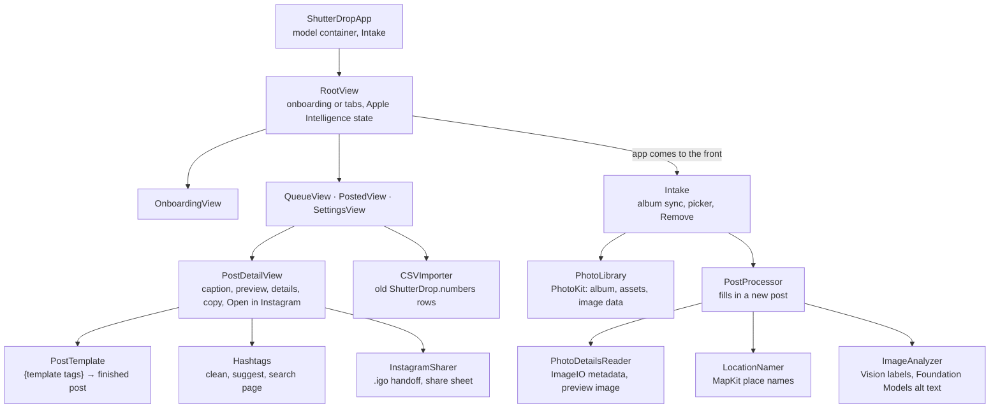

# How ShutterDrop is put together

ShutterDrop is one SwiftUI app, `app/Sources/ShutterDrop`, built from the Xcode project `app/ShutterDrop.xcodeproj`. The project uses synchronized folders, so every file in `Sources/ShutterDrop` is part of the app and every file in `Tests/ShutterDropTests` part of the tests, with no project edits for new files.

## Who owns what

| Piece | Isolation | Owns |
| --- | --- | --- |
| `Post` | SwiftData model | One photo on its way to Instagram: what was read from it, what the user typed, and whether it's posted. Keyed by the photo's Photos library ID |
| `PostTemplate` | — | Turning a template and a post's values into the finished post: filling tags, dropping lines whose tags are all empty, collapsing blank lines |
| `PostFormat` | — | How readings read in a post: "1/125", "f/5.6", "Model with Lens", "March 1, 2025" |
| `PhotoLibrary` | main actor, `@Observable` | PhotoKit: permission, the ShutterDrop album, assets and their image data |
| `Intake` | main actor, `@Observable` | How photos get into the queue and leave it: album sync, the photo picker, Remove |
| `PostProcessor` | main actor | Filling in a new post: details, place name, Vision labels, alt text. It coordinates; the heavy work runs elsewhere |
| `PhotoDetailsReader` | `load` and `preview` are `@concurrent` | EXIF, TIFF and GPS metadata, and the upright 1568 px copy the models see |
| `LocationNamer` | — | MapKit reverse geocoding and nearby landmarks, and the rules for which name to use: a named place, the neighborhood from the short address, a nearby landmark, then the city. Uses only MapKit's current address types, not the deprecated placemark |
| `PlaceLookups` | actor | Spacing MapKit requests 1.2 seconds apart, caching names for nearby spots (about 100 m) so a burst of photos from one place costs one lookup, and pausing once when MapKit throttles |
| `ImageAnalyzer` | — | Vision scene labels and text recognition, the on-device alt text, and the Private Cloud Compute draft (landmark, alt text, hashtags) |
| `AppleIntelligence` | — | Whether the on-device model can run, as one of four states, and what the alt text setting says in each |
| `CloudModel` | — | The Private Cloud Compute model: whether it's usable (setting, availability, daily limit) and what Settings says about it |
| `SunPosition` | — | The sun's elevation and direction from a time and place, and the light it makes: daylight, golden hour, blue hour, night |
| `Hashtags` | — | Cleaning pasted text, suggestions, the search page address |
| `InstagramSharer` | main actor | Handing the photo to Instagram as an `.igo` file, or the share sheet |
| `CSVImporter` | `importPosts` on the main actor | Parsing the old sheet's CSV and matching rows to photos |
| `AppSettings` | — | Settings keys and defaults, shared by `@AppStorage` and services |
| `DebugOptions` | — | Launch arguments for simulator screenshots. Debug builds only |
| `Log` | — | One `Logger` per area, under the subsystem `com.chipcressman.shutterdrop` |

## Rules that hold everywhere

- **Nothing touches PhotoKit before the user answers.** Any PhotoKit fetch before permission is decided brings up the system prompt, so every read in `PhotoLibrary` checks the status first, and the photo picker is linked to the library only once access is granted. The prompt appears only when the user taps Allow Photo Access in onboarding.
- **The main thread only coordinates.** Decoding photos, filename lookups, Vision, Apple Intelligence and MapKit all run off the main actor (`@concurrent` functions, the `PlaceLookups` actor, or the frameworks' own async work), and `Intake` reads one photo at a time, so a 150-photo album doesn't stall scrolling. `Intake.progress` drives the queue's subtitle while it works. PhotoKit change and image request closures are `@Sendable`, because PhotoKit calls them on its own queues and a main-actor closure crashes there.
- **Photos leave the device only with Private Cloud Compute on.** Vision and the on-device model run on the device. Otherwise the only network use is MapKit place names (behind the Location Lookups setting), the hashtag search page the user opens, and the handoff to Instagram the user taps. Private Cloud Compute is off by default; `AppSettings.cloudEnabled` gates every request.
- **Every new photo goes Vision, then MapKit, then Apple Intelligence.** Vision's labels steer MapKit (a "lighthouse" label looks for a lighthouse nearby by name, since many landmarks have no MapKit category). MapKit's name stands unless Private Cloud Compute picks a landmark; its alt text and hashtag ideas win when it runs, and the on-device model writes the alt text when it doesn't (off, offline, over the daily limit, or no entitlement).
- **Apple Intelligence is optional.** The app works the same without it. `RootView` keeps the state current (whenever the app comes to the front, and every few seconds while the model downloads) and shares it as `\.appleIntelligence`. Alt text is written only when the user wants it (`AppSettings.altTextEnabled`) and either the on-device state is `.ready` or Private Cloud Compute is usable; when that becomes true, `Intake.fillMissingAltText` fills in queued posts that came in without it.
- **Every field is editable per post; the layout is not.** Each post keeps its own location, camera line, exposure, date, hashtags and alt text, which the user can change. The template (tags, emojis, line breaks) lives only in Settings.
- **Missing readings drop out.** `PostFormat` returns an empty string for a reading the photo doesn't have, so its token leaves the exposure line and an all-empty line leaves the post.
- **Posted posts stay.** Album sync removes queue items whose photo left the album or was deleted, but never a post already marked as posted.
- **Native controls first.** Standard SwiftUI views, the system tab bar, `Form`, `ContentUnavailableView`, `PhotosPicker`, `PasteButton` and `SFSafariViewController`, in one dark look (`Palette`).
